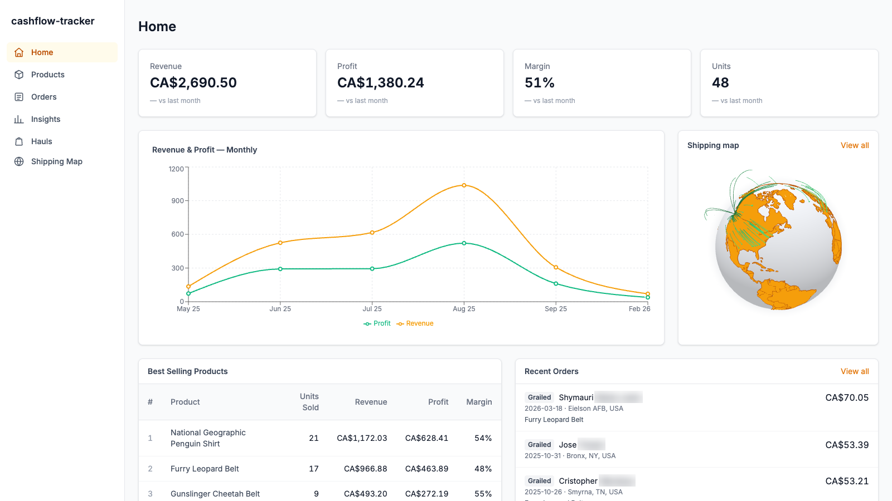

# cashflow-tracker

Summer 2025 I started reselling clothes. Initially on Facebook
Marketplace, then on Grailed, Depop, and eBay. Then I started to market my business on TikTok.

My videos did well and sales started to ramp up. I needed a better way to
track profits than on paper.


So I created this.

> **Demo:** [Watch the demo video](docs/cashflow-demo.mp4) or [here](https://fpettit-portfolio.vercel.app/projects/cashflow-tracker).

## What I use it for



The home page is what I check most. Revenue, profit, margin and units for the
month, how that compares to last month, and revenue against profit by month.

When a sale comes in on Grailed, Depop or eBay the worker picks up the
confirmation email and the order shows up on its own, tagged as imported. If
something I buy in person sells, I add it by hand on the Orders page. Products
hold what I paid for each item, so profit is worked out per unit sold instead
of me doing it after the fact.

Insights is where I go to see which products and platforms are actually
making money, by month or by day, and I can narrow it to one platform, one
product or one country. The globe plots where every order shipped to. Hauls is
a separate ledger for my own clothes buying and flipping, so it doesn't mix
with the business numbers.

More screenshots are in `docs/ui/`.

## How it's built

```
┌──────────────┐     /api      ┌───────────────────┐   JPA    ┌────────────┐
│  React SPA   │ ────────────► │  Spring Boot API  │ ───────► │ PostgreSQL │
│ (Vite + TS)  │               │     (Java 21)     │          └────────────┘
└──────────────┘               │                   │ ───────► ┌────────────┐
                               └───────────────────┘  cache   │   Redis    │
                                         ▲                    └────────────┘
                                         │ PUT /api/orders/external/{platform}/{ref}
                               ┌─────────┴─────────┐   pull   ┌────────────┐   push  ┌───────────┐
                               │  Go worker        │ ◄─────── │  Pub/Sub   │ ◄────── │ Gmail API │
                               │ (goroutine pool)  │          └────────────┘ watch() └───────────┘
                               └───────────────────┘
```

- **Frontend** — React 19 + TypeScript, built with Vite and styled with
  Tailwind CSS. TanStack Query for data fetching, Recharts for the stats
  dashboards, react-globe.gl for the shipping globe. Component tests with
  Vitest + Testing Library.
- **Backend** — Spring Boot 3 (Java 21) REST API with controller/service/
  repository layering, JPA entities, and DTOs at the API boundary. Data lives
  in PostgreSQL, with SQL views powering the stats. Stats responses are cached
  in Redis and evicted on every order/product write — measured at **20.6x**
  overall across the ten stats endpoints (per-endpoint 10.3x–44.7x) on a
  20 000-order synthetic dataset; see `docs/benchmark.md`.
- **Worker** — Go service: Gmail `watch()` pushes new-mail notifications to
  Google Pub/Sub; a streaming-pull worker with a configurable goroutine pool
  fetches each email, parses Grailed/Depop/eBay sale confirmations, and upserts
  exactly one order per marketplace order ID through the Spring API.
  Unparseable emails are nacked and dead-lettered.
  Production setup (GCP resources, IAM, OAuth) is in `worker/README.md`;
  `scripts/gcp-setup.sh` creates the Pub/Sub side.

**What the numbers mean.** The speedup is a localhost, single-client,
sequential measurement with no concurrent writes (`scripts/bench.sh`
reproduces it and rewrites `docs/benchmark.md`). Cache entries are evicted on
every order and product write, so the UI never shows stale totals; the cost is
that the first stats request after a write pays the uncached price. Sales
figures in the intro are my own records, not generated by this code.

**How I test it.** `./scripts/verify.sh` runs everything and fails if any
part does. On the frontend that's ESLint, `tsc` and Vitest with Testing
Library, including axe accessibility checks on each page. The backend runs
its JUnit tests against a real PostgreSQL through Testcontainers, so the SQL
views are tested for real and not mocked. The worker runs `go vet` and
`go test` in Docker, with sample Grailed, Depop and eBay emails as parser
fixtures. You need Docker Desktop and Java 21; nothing else is installed on
the host.

<details>
<summary>If you have a use case for this, here's how to set it up locally:</summary>

### Quick start (Docker)

```bash
cp .env.example .env
docker compose up --build
```

- UI: http://localhost:3000
- API: http://localhost:8080/api/health
- Worker: http://localhost:8090/health

For a seeded demo stack with a simulated live Gmail sale, see
[demo/README.md](demo/README.md).

The default compose stack runs the worker against the Pub/Sub emulator with no
Gmail token; for the real Gmail + Pub/Sub configuration see
[worker/README.md](worker/README.md).

### Native development

Requires Java 21, Node.js 20+, and PostgreSQL.

```bash
# database
createdb cashflow_tracker_db
psql cashflow_tracker_db -f app/database/create_tables.sql
psql cashflow_tracker_db -f app/database/create_views.sql
psql cashflow_tracker_db -f app/database/migrations/002_external_ref.sql
psql cashflow_tracker_db -f app/database/migrations/003_coordinates_platforms.sql

# backend — http://localhost:8080
./gradlew :app:bootRun

# frontend — http://localhost:5173
cd frontend && npm install && npm run dev
```

Datasource credentials are in `app/src/main/resources/application.properties`.
To run against your own existing database set `DB_URL` (and `DB_USER`/`DB_PASSWORD`), e.g.
`DB_URL=jdbc:postgresql://localhost:5432/archivelol_db ./gradlew :app:bootRun`.
The Gmail worker is optional — see [worker/README.md](worker/README.md).

</details>
