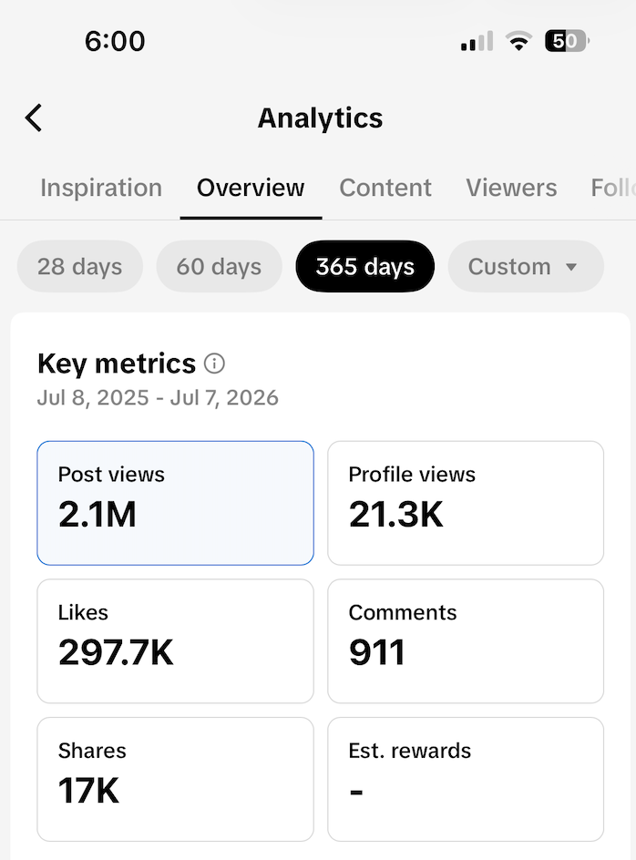

# cashflow-tracker

Summer 2025 I started reselling clothes. Initially on Facebook
Marketplace, then on Grailed, Depop, and eBay. Then I started to market my business on TikTok.

My videos did well and sales started to ramp up. I needed a better way to
track profits than on paper.



So I created this.

> **Demo:** [Watch the demo video](docs/cashflow-demo.mp4) or [here](https://fpettit-portfolio.vercel.app/projects/cashflow-tracker).

## How it's built

```
┌──────────────┐     /api      ┌───────────────────┐   JPA    ┌────────────┐
│  React SPA   │ ────────────► │  Spring Boot API  │ ───────► │ PostgreSQL │
│ (Vite + TS)  │               │     (Java 21)     │          └────────────┘
└──────────────┘               │                   │ ───────► ┌────────────┐
                               └───────────────────┘  cache   │   Redis    │
                                         ▲                    └────────────┘
                                         │ PUT /api/orders/external/{platform}/{ref}
                               ┌─────────┴─────────┐   pull   ┌────────────┐  push  ┌───────────┐
                               │  Go worker        │ ◄─────── │  Pub/Sub   │ ◄───── │ Gmail API │
                               │ (goroutine pool)  │          └────────────┘ watch() └───────────┘
                               └───────────────────┘
```

- **Frontend** — React 19 + TypeScript, built with Vite and styled with
  Tailwind CSS. TanStack Query for data fetching, Recharts for the stats
  dashboards, react-globe.gl for the shipping globe. Component tests with
  Vitest + Testing Library.
- **Backend** — Spring Boot 3 (Java 21) REST API with controller/service/
  repository layering, JPA entities, and DTOs at the API boundary. Data lives
  in PostgreSQL, with SQL views powering the stats. Stats responses are cached
  in Redis and evicted on every order/product write (see `docs/benchmark.md`
  for the measured speedup).
- **Worker** — Go service: Gmail `watch()` pushes new-mail notifications to
  Google Pub/Sub; a streaming-pull worker with a configurable goroutine pool
  fetches each email, parses Grailed/Depop/eBay sale confirmations, and upserts
  exactly one order per marketplace order ID through the Spring API.
  Unparseable emails are nacked and dead-lettered.

<details>
<summary>If you have a use case for this, here's how to set it up locally:</summary>

Requires Java 21, Node.js 20+, and PostgreSQL.

```bash
# database
createdb cashflow_tracker_db
psql cashflow_tracker_db -f app/database/create_tables.sql
psql cashflow_tracker_db -f app/database/create_views.sql

# backend — http://localhost:8080
./gradlew :app:bootRun

# frontend — http://localhost:5173
cd frontend && npm install && npm run dev
```

Datasource credentials are in `app/src/main/resources/application.properties`.
The Gmail worker is optional — see [worker/README.md](worker/README.md).

</details>
